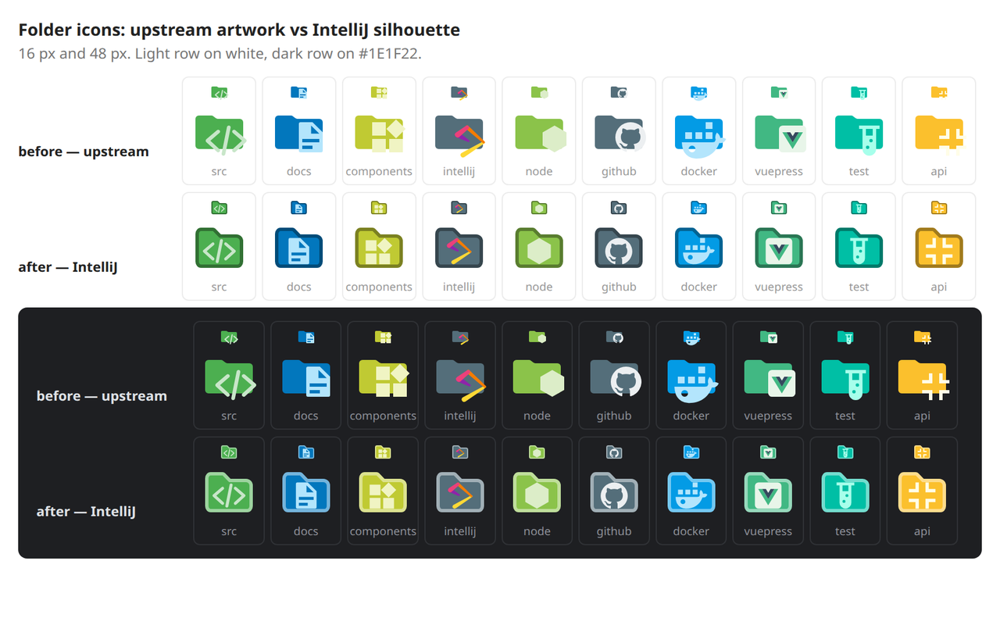

# Material Icons for IDEs

An IntelliJ Platform plugin that gives files and folders the icons and name/extension
associations of the [Material Icon Theme](https://github.com/material-extensions/vscode-material-icon-theme)
(the icon theme behind VS Code's "Material Icon Theme" extension). Free and MIT-licensed.

The complete upstream theme is bundled: **1256 icons**, 2156 exact file names, 1391 file
extensions and 4674 folder names (material-icon-theme 5.40.0, MIT).

File icons are upstream artwork unchanged. **Folder icons are not**: each one keeps the upstream
colour and symbol but is redrawn on IntelliJ's own folder silhouette, with the symbol re-fitted
into a shared box, so a folder in the Project View still looks like an IntelliJ folder.



## Install

The plugin targets IntelliJ-based IDEs **2026.2** (build 262) and newer. It uses only platform
APIs, so it works in IDEA, WebStorm, PyCharm, Rider and the rest.

It is published on the JetBrains Marketplace and currently awaiting the first review:
<https://plugins.jetbrains.com/plugin/35596-material-icons-for-ides>. Once approved, install it
from **Settings | Plugins | Marketplace**.

Until then, install a local build:

```bash
./gradlew buildPlugin
```

Then open **Settings | Plugins | ⚙ | Install Plugin from Disk…** and pick
`build/distributions/intellij-material-icons-0.1.1.zip`.

After installing, enable **Apply Material icons to files and folders without a custom
association** under **Settings | Appearance & Behavior | Material Icons** for the complete look;
otherwise only associated names and extensions are replaced.

## Why this architecture

Icon plugins easily become a performance problem. This one avoids the known pitfalls:

- **No `IconPathPatcher`.** Nothing is rewritten globally. The plugin only answers icon requests
  through the two provider extension points the platform offers for this.
- **No `ProjectViewNodeDecorator`, no forced Project View refreshes** on editor focus, project
  open or tree repaint.
- **No PSI traversal, no index access, no file I/O** while resolving an icon. Everything is a hash
  lookup on the file name against maps built once at construction.
- **No eager loading of SVGs.** `IconLoader` loads and caches icons lazily by path, including
  `_dark`/`@2x` variants for the current theme and HiDPI scale.
- **No custom icon cache.** The platform's cache is authoritative, so LAF switches and theme
  changes cannot leave stale icons behind.
- **Cache invalidation only on explicit settings changes** (`IconLoader.clearCache()` +
  `ProjectView.refresh()`), never from a provider.
- **Stateless, thread-safe, dumb-aware providers.** All state lives in application services.

Measured on the bundled 1256-icon theme (JMH-free, single JVM run, so treat as ballpark):
first parse ~25 ms, warm parse ~8 ms (done once, off the UI thread), and ~35 ns per file/folder
lookup (200 000 lookups in 6–8 ms).

## How icons are resolved

Files (`com.intellij.fileIconProvider`, `order="first"`), highest precedence first:

1. user association matching the exact file name
2. theme association matching the exact file name
3. user association matching the longest file extension (`spec.ts` before `ts`)
4. theme association matching the longest file extension
5. the theme's default file icon, if `applyDefaultIcons` is enabled

Folders (`com.intellij.iconProvider`, `order="first"`, `PsiDirectory`):

1. user association matching the folder name
2. theme association matching the folder name
3. the theme's default folder icon, if `applyDefaultIcons` is enabled

Folders reach the Project View through `PsiDirectoryNode.setupIcon` →
`CompoundIconProvider` → `com.intellij.iconProvider`, which honours `order="first"`. When no
association matches, the provider returns `null` so the IDE keeps its own icon — including the
blue source-root decoration.

Open (expanded) folder icons are deliberately **not** implemented: the platform has no API for
them, and faking them needs a `ProjectViewNodeDecorator` plus targeted tree refreshes, which is
exactly the overhead this plugin exists to avoid.

## Project layout

```
src/main/kotlin/io/github/tser239/materialicons/
  icons/
    IconTheme.kt                  # pure lookup logic, no platform dependencies
    IconThemeLoader.kt            # reads the Material Icon Theme JSON manifest
    MaterialIconsService.kt       # application service: lazy theme + IconLoader bridge
    MaterialIconsPreloader.kt     # background theme warm-up after project open
    MaterialFileIconProvider.kt   # com.intellij.fileIconProvider (files)
    MaterialFolderIconProvider.kt # com.intellij.iconProvider (directories)
    IconAssociation.kt / AssociationKind.kt
  settings/
    MaterialIconsSettings.kt      # persisted state (material-icons.xml)
    MaterialIconsConfigurable.kt  # Settings | Appearance & Behavior | Material Icons
    AssociationTextFormat.kt      # text format for custom associations (unit-tested)
    MaterialIconsRefresher.kt     # explicit icon refresh
src/main/resources/
  META-INF/plugin.xml
  themes/material/material-icons.json   # upstream manifest, unchanged
  themes/material/icons/*.svg           # 1256 upstream drawings + 271 folder re-skins
  themes/material/LICENSE               # upstream MIT license (restored on re-import)
  licenses/APACHE-2.0.txt               # for the folder silhouette and Gson
src/test/kotlin/                  # plain JVM tests, no IDE required
tools/import-material-theme.sh    # re-imports the complete upstream theme
tools/reskin_folders.py           # re-skins folder icons on IntelliJ's silhouette
tools/folder-geometry.json        # measured artwork boxes, cache for the re-skin
```

## Build and run

Requirements: a JDK 21+ to start Gradle (the build provisions a Java 25 toolchain automatically),
network access for the IntelliJ Platform artifacts, and ~1.5 GB of free space.

```bash
./gradlew build          # compile + tests + plugin ZIP in build/distributions
./gradlew test           # 32 plain-JVM unit tests
./gradlew runIde         # starts a sandboxed IntelliJ IDEA 2026.2.3
./gradlew verifyPlugin   # Plugin Verifier
```

If no system JDK is installed, use the JBR bundled with any JetBrains IDE, for example:

```bash
JAVA_HOME="$HOME/.local/share/JetBrains/Toolbox/apps/webstorm/jbr" ./gradlew runIde
```

For fast local iteration, build and verify against an IDE that is already installed instead of
downloading the platform (~1.5 GB) or a verifier IDE (~2 GB):

```bash
export JAVA_HOME="$HOME/.local/share/JetBrains/Toolbox/apps/webstorm/jbr"
./gradlew test buildPlugin \
  -PlocalIdePath="$HOME/.local/share/JetBrains/Toolbox/apps/webstorm"
./gradlew verifyPlugin \
  -PverifyIdePath="$HOME/.local/share/JetBrains/Toolbox/apps/webstorm"
```

The plugin compiles against IntelliJ IDEA **2026.2.3**, declares `since-build=262` (2026.2) and
targets Java 25, which is the JBR shipped with 2026.2. It depends only on
`com.intellij.modules.platform`, so it installs in IDEA, WebStorm, PyCharm, Rider, etc.
`verifyPluginConfiguration` reports no issues, and the Plugin Verifier reports `Compatible`
against WS-262.10968.77.

## Release

The version lives in `gradle.properties` (`pluginVersion`); the change notes live in
`build.gradle.kts` (`pluginConfiguration.changeNotes`). For a release:

1. Bump `pluginVersion`, update the change notes, and commit.
2. Tag the commit and push the tag:

   ```bash
   git tag -a v0.1.1 -m "v0.1.1"
   git push origin v0.1.1
   ```

3. The [Release workflow](.github/workflows/release.yml) runs the tests and the Plugin Verifier,
   publishes to the Marketplace when `PUBLISH_TOKEN` is configured, and attaches the ZIP to a
   GitHub release. Pushing to `main` runs the lighter [Build workflow](.github/workflows/build.yml).

Everything can be done locally too:

```bash
./gradlew test buildPlugin verifyPlugin
gh release create v0.1.1 build/distributions/*.zip --generate-notes
PUBLISH_TOKEN=... ./gradlew publishPlugin
```

**The first Marketplace upload is always manual** — JetBrains requires the plugin to exist before
Gradle can publish updates. That was done for 0.1.0, which is listed as
[plugin 35596](https://plugins.jetbrains.com/plugin/35596-material-icons-for-ides). Add the
`PUBLISH_TOKEN` secret afterwards; every later version can then be published by the workflow or by
`publishPlugin`. Each upload goes through moderation, so wait until the current version is approved
before tagging the next one.

### Signing

Signing is optional, but without a signature the IDE shows a warning when installing the plugin.
The build signs automatically when these environment variables are present, so no certificate is
ever committed:

| Variable | Value |
| --- | --- |
| `CERTIFICATE_CHAIN` | Base64 of the certificate chain (`base64 -w0 chain.crt`) |
| `PRIVATE_KEY` | Base64 of the RSA private key (`base64 -w0 private.pem`) |
| `PRIVATE_KEY_PASSWORD` | Passphrase chosen when generating the key |
| `PUBLISH_TOKEN` | Marketplace token from <https://plugins.jetbrains.com/author/me/tokens> |

Generate a key pair and a self-signed certificate (valid for ten years):

```bash
openssl genpkey -aes-256-cbc -algorithm RSA -out private_encrypted.pem \
  -pkeyopt rsa_keygen_bits:4096
openssl rsa -in private_encrypted.pem -out private.pem
openssl req -key private.pem -new -x509 -days 3650 -out chain.crt
```

For GitHub Actions, add the four values under **Settings | Secrets and variables | Actions** of
the repository. `signPlugin` and `publishPlugin` read them from the environment. `publishPlugin`
runs `signPlugin` first when the certificate and key are available.

## Icon theme

The loader understands the upstream `material-icons.json` format:

```json
{
  "iconDefinitions": { "kotlin": { "iconPath": "./../icons/kotlin.svg" } },
  "fileNames":      { "dockerfile": "docker" },
  "fileExtensions": { "kt": "kotlin", "spec.ts": "test-ts" },
  "folderNames":    { "src": "folder-src" },
  "file": "file",
  "folder": "folder"
}
```

Icon paths are resolved by **file name** into `themes/<themeId>/icons/`, which is why the
upstream `./../icons/...` paths work unchanged. Sections that would not change a single icon
(`languageIds`, `light`, `highContrast`, `rootFolder*`, `folderNamesExpanded`, file nesting) are
skipped while parsing, so they cost neither time nor memory.

To update the bundled theme:

```bash
tools/import-material-theme.sh          # latest upstream release
tools/import-material-theme.sh 5.40.0   # pinned release
```

The import needs `python3` and Chrome or Chromium (used to measure the folder artwork); the plugin
itself has no such dependency.

This replaces `src/main/resources/themes/material/` (manifest, icons, upstream `LICENSE`) and
needs no code changes. The tests fail loudly if the import is partial or if an association points
at an icon that is not bundled.

### Folder artwork

Upstream ships 580 folder drawings, of which the plugin can select 271 (the closed-folder set;
expanded folders are not implemented). `tools/import-material-theme.sh` passes those through
`tools/reskin_folders.py`, which:

- replaces the upstream folder body with the IntelliJ Platform silhouette from
  `expui/nodes/folder.svg`, keeping the upstream colour;
- scales and centres the upstream artwork into one shared 9.6 × 7.8 box on `(8, 9)`, inside the
  outline, so every folder type has the same anchor and the same extents;
- writes a `_dark` twin per folder, which the platform picks automatically. Only the outline
  colour differs: a few drawings paint in the body colour (VuePress' cut-out, Form's cube) or are
  darker than it (Bower), so recolouring the body would erase them.

The artwork boxes come from Chromium's `getBBox()`, which handles arcs, groups and `<use>`
correctly. They are cached in `tools/folder-geometry.json`, so a re-run can use `--no-measure`
and skip the browser:

```bash
python3 tools/reskin_folders.py --theme-dir src/main/resources/themes/material --no-measure
```

Folder artwork is Apache-2.0 (JetBrains) on top of MIT (Material Icon Theme); see
`THIRD_PARTY_NOTICES.md`.

## Custom associations

Settings are stored in `material-icons.xml` and can be edited under
**Settings | Appearance & Behavior | Material Icons** as one association per line:

```
# kind:pattern=icon-id
extension:kt=kotlin
extension:.vue=vue
file:Makefile=make
folder:.github=github
```

Icon ids are the keys of `iconDefinitions` in the bundled manifest. Unknown ids are ignored and
logged once.

`Apply Material icons to files and folders without a custom association` is **off by default**, so
the plugin only replaces icons it has an association for; turn it on for a complete VS Code-like
look.

The **Refresh icons** button clears the platform icon cache and refreshes the Project View of all
open projects. It is only needed if a file does not repaint on its own after changing settings.

## Attribution

The bundled icons are from
[Material Icon Theme](https://github.com/material-extensions/vscode-material-icon-theme),
Copyright (c) 2025 Material Extensions, licensed under the MIT License. See
`src/main/resources/themes/material/LICENSE` and `THIRD_PARTY_NOTICES.md`.

The folder silhouette in the re-skinned folder icons is from the IntelliJ Platform,
Copyright 2000-2022 JetBrains s.r.o., licensed under the Apache License 2.0
(`src/main/resources/licenses/APACHE-2.0.txt`).

Full license texts for everything the plugin ships are in `LICENSE`,
`src/main/resources/themes/material/LICENSE` and `src/main/resources/licenses/APACHE-2.0.txt`.

## Support

The plugin is free, with no paid tiers or telemetry. If it saves you time, you can
[buy me a coffee on Ko-fi](https://ko-fi.com/tser239) — donations are optional and unlock no
features; they are handled entirely by Ko-fi and the plugin contains no payment code.

Bug reports and feature requests:
[github.com/tser239/intellij-material-icons/issues](https://github.com/tser239/intellij-material-icons/issues).

## License

The plugin's own code is licensed under the MIT License, Copyright (c) 2026 tser239; see
[LICENSE](LICENSE).

Bundled third-party material keeps its own license:

| Asset | License |
| --- | --- |
| 1256 icons and the manifest (Material Icon Theme 5.40.0) | MIT, Copyright (c) 2025 Material Extensions |
| Folder silhouette (IntelliJ Platform) | Apache-2.0, Copyright 2000-2022 JetBrains s.r.o. |
| Gson 2.13.2 | Apache-2.0 |

